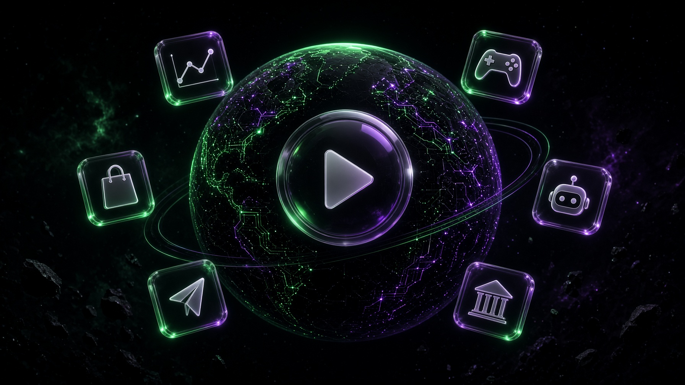
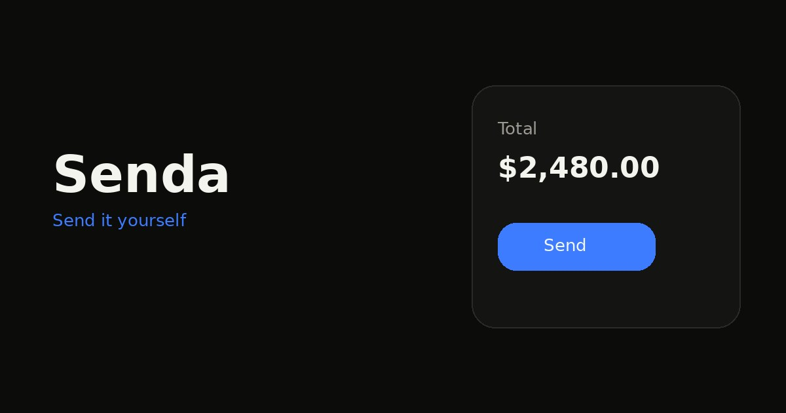

  

# SENDA
### Your wallet. A world of possibilities.

**Bring Your Own Wallet (BYOW).** Connect what you already own. Discover, trade, move, and use digital assets from one desk — with your wallet in control.

[**Open Senda**](https://senda.pocketnova.app) · [**Explore the desk**](#the-desk) · [**Wallet support**](#your-wallet-comes-first) · [**Developers**](#for-builders)

 

---

## One wallet. More possibilities.

Senda is not just a PreStocks app. It connects **crypto trading, tokenized markets, USDC payments, liquidity research, portfolio tools, and governed AI** in a single wallet-first workspace.

| **BUY & TRADE** | **CONVERT** | **SEND** |
| :--- | :--- | :--- |
| Discover Solana markets, xStocks, PreStocks and supported derivatives venues. | Inspect Jupiter and supported LI.FI routes before signing. | Send USDC and create wallet-signed payment requests. |
| [Explore Trade](https://senda.pocketnova.app/invest) | [Open Convert](https://senda.pocketnova.app/wallet) | [Open Payments](https://senda.pocketnova.app/payments) |
| **RESEARCH** | **PLAY & CREATE** | **AI AGENTS** |
| Liquify quote-size curves, pool candles, Solscan activity and market-quality checks. | Explore market-based experiences, work listings and creative tools. | Give bounded agents research tasks; approve any resulting wallet action yourself. |
| [Market Intelligence](https://senda.pocketnova.app/market-intelligence) | [Explore Senda](https://senda.pocketnova.app/social) | [Agent Studio](https://senda.pocketnova.app/agents) |

  
  

Images and videos above are existing Senda repository assets. A card visual is not proof of a scheme-issued payment card. Venue access depends on the wallet, chain, liquidity and provider.

## Your wallet comes first

**Bring your own wallet. Keep your signing authority.** Senda connects to compatible installed wallets; it does not need your recovery phrase or take ownership of the signing key for ordinary wallet-signed swaps and transfers.

| Solana wallet adapters | EVM wallet adapters |
| --- | --- |
| **Phantom · Solflare · Backpack · Glow** | **MetaMask · Rabby** |
| OKX · Bitget · Trust · Coinbase (Solana) | Coinbase Wallet · Brave Wallet |

Adapters are implemented in [wallet detection](src/lib/wallets.ts). Availability depends on browser, wallet provider and device; **not every wallet signs every route**.

**Connect → Inspect quote → Approve in your wallet → Verify on-chain.**

Your balances come from the connected wallet and chain reads. A market price is not an executable quote, and a submitted signature is not a confirmed fill. Some experimental pocket and game-pot features use **device-generated keys**, a different security model that requires additional review before funded use.

  
  

## The desk

### Markets without the silos

Explore Solana spot markets, stablecoins, tokenized listed equities, PreStocks, liquid staking and supported EVM instruments. Senda also contains venue-specific code for **Jupiter Perps, Hyperliquid and Ostium**. Availability and permissions are determined by each external venue, and tokenized exposure is not necessarily direct ownership of underlying shares.

| Market lane | What Senda connects |
| --- | --- |
| **Crypto & stablecoins** | SOL, USDC, selected USDT/PYUSD routes, and quote-eligible Solana tokens |
| **Tokenized assets** | PreStocks, Tessera, xStocks, and xStocks/Kamino market research |
| **EVM markets** | Listed routes for WETH, WBTC, LINK, UNI, ARB, OP, WBNB and WAVAX; supported chains vary by venue |
| **Trading & derivatives** | Wallet-signed venue integrations, price research, and separate experimental derivatives tools |

[Market catalog](docs/OFFERINGS.md) · [Solana/EVM routes](src/lib/trade-book.mjs) · [Instrument book](src/lib/sol-house.ts)

### Liquify: measure the route, not the hype

Senda's **Liquify** tools sample real *indicative* Jupiter quote sizes, analyze observed pools and index Solscan activity through a read-only Go service. They do **not** claim to operate an exchange, supply resting orders, or guarantee settlement.

[Liquify Go service](services/liquify/README.md) · [Volume methodology](docs/native-solscan-volume.md) · [Market Intelligence](https://senda.pocketnova.app/market-intelligence)

### Move value

Wallet-signed Solana USDC transfers, requests and Solana Pay links sit alongside chain-dependent bridging and payments research. Senda does **not** itself guarantee fiat withdrawal, bank settlement, merchant card acceptance or a Mexico cash-out.

[Payment code](src/lib/solana-pay.ts) · [LI.FI routes](src/lib/lifi.ts)

### Intelligence you govern

Senda's agent workspace can watch markets, produce research, create notes and queue bounded actions. **The wallet still signs.** Utility AI uses evidence-led reports, while Genesis offers collectible-aware research workflows when ownership verification is configured.

[Agent workspace](src/lib/agent-workspace.ts) · [Utility AI](docs/production-utility-ai.md) · [Genesis runtime](src/lib/genesis-runtime.mjs) · [Read-only MCP](mcp/README.md)

  
  

## Built with an open financial ecosystem

Rather than an enormous wall of logos, Senda documents integrations **by what they actually do**.

| Execution & routing | Data & market discovery | Intelligence & infrastructure |
| --- | --- | --- |
| **Jupiter** swaps and perps | **GeckoTerminal** pool OHLCV | **Go Liquify** quote research |
| **LI.FI** EVM/bridge routes | **Solscan Pro** indexed activity | **Senda MCP** read/quote tools |
| **Hyperliquid · Ostium** venue adapters | **PreStocks · Tessera · xStocks** | **Utility AI · Genesis · PARRALAX** |
| **Solana Pay** transfers | **Kamino** market metrics; selected public prediction-market feeds | Optional model/API and ownership verification |

Integration code is not equal to an active partnership or universal live access. Solscan Pro, certain AI services, Genesis verification and commercial card APIs require their own provider configuration. PARRALAX's on-chain risk interface is a design contract, not a funded settlement program.

## What is available — and what is still being built

| Area | Implementation boundary |
| --- | --- |
| **Wallet-first core** | Wallet detection, transaction construction, swap and transfer signing paths, confirmation/recovery logic. Needs actual provider and end-to-end release verification. |
| **Markets & Liquify** | Live-source adapters, venue-specific routes, research models and quote-only Go infrastructure. No Senda-owned liquidity guarantee. |
| **AI & Genesis** | Browser-local bounded agents and research, optional server-side model, optional on-chain asset verification. No autonomous wallet signing. |
| **Payments & cards** | Wallet-signed USDC payments exist in code. Browser-local checkout numbers are not network-accepted cards; Mastercard Commercial Connect is a separate configuration-gated integration. |
| **Cover & borrowing** | Research/prototype features; devnet cover terms are **not** an oracle-settled, fully reserved insurance payout. Local loan records are **not** funded lending. |

See the [repository-wide code audit](docs/REPOSITORY_CODE_AUDIT_2026-11-02.md) and [Senda × PARRALAX boundaries](docs/SENDA_PARRALAX_ONCHAIN_V1.md) for implementation details and outstanding security/verification work.

## For builders

Senda's application is built with **React, TypeScript, TanStack Start/Router and Vite**, with Solana wallet libraries, venue integrations, a separate **Go Liquify** service, Rust on-chain experiments, and read-only MCP tools.

~~~bash
npm install
npm run dev
~~~

The local web app uses port **8080**.

<strong>Verification and service commands</strong>

~~~bash
npm run typecheck
npm test
npm run build:dev

cd services/liquify
go test -race ./...
go vet ./...
go run .
~~~

Extra Rust/Python checks are documented in [the code audit](docs/REPOSITORY_CODE_AUDIT_2026-11-02.md). A configured build can run database migrations; do not expose private provider API keys or wallet secrets to client code.

<strong>Program status, production gates and operational notes</strong>

- [Repository architecture and risks](docs/REPOSITORY_CODE_AUDIT_2026-11-02.md)
- [Modules and code entrypoints](docs/MODULES.md)
- [On-chain design boundaries](docs/SENDA_PARRALAX_ONCHAIN_V1.md)
- [Wallet execution guardrails](docs/WALLET_GUARDS_STATUS.md)
- [Operator handoff](HANDOFF.md)
- [Contributor instructions](AGENTS.md)

The recorded Solana [devnet cover program](chain/devnet.json) stores policy terms only; it does not operate a funded payout pool. Current production compilation, deployed provider behavior, actual token liquidity and security review must be independently verified. A source-backed claim is not automatically a completed live transaction.

---

  

  <strong>Bring Your Own Wallet. Keep your options open.</strong> 
  <a href="https://senda.pocketnova.app">senda.pocketnova.app</a> ·
  <a href="https://github.com/ItsNotAILABS/Senda">ItsNotAILABS / Senda</a>

